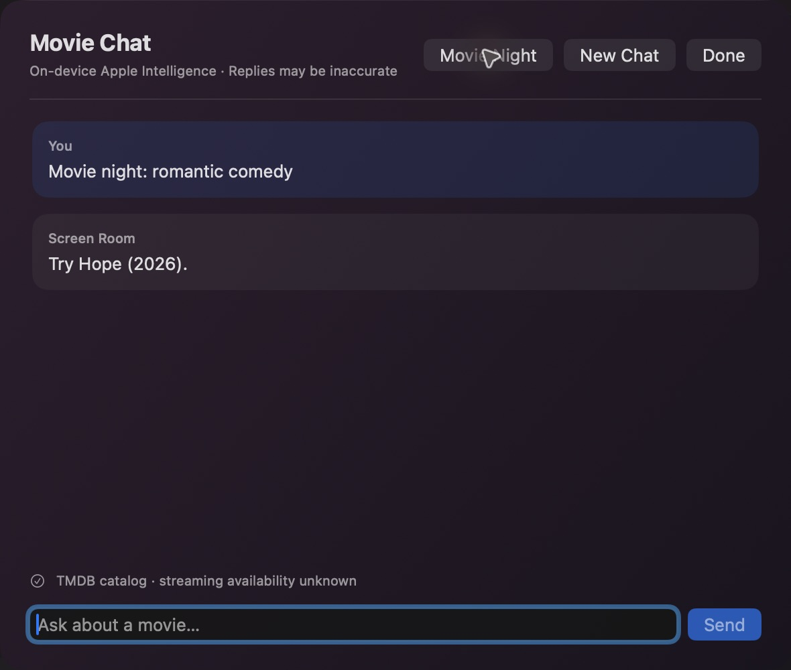

# Screen Room Remote

A local macOS prototype for controlling a compatible Fire OS device, looking up films and chatting about movies. Built with SwiftUI, App Intents and Apple Foundation Models.

## What works

- Home, Back, directional, Select, Play/Pause, Resume, Forward and volume-key commands over a paired ADB connection. TV and audio hardware support varies.
- Netflix and YouTube app launch, an experimental YouTube video link, and an on-demand TV screenshot. Some Fire TV YouTube versions ignore link requests. Screenshots can be saved explicitly or described on-device using Apple Intelligence; some apps block capture.
- Film search using the bundled Screen Room catalog. Add your own TMDB API key or v4 read token in the search sheet to use the live catalog; the app stores it in macOS Keychain. The film query is sent to TMDB. Without a key, three sample films are available.
- A Now Playing panel reads the active media session reported by the TV; it does not infer titles from images. Refresh is manual.
- Text chat using Apple Foundation Models on a supported Mac with Apple Intelligence enabled. The Movie Night button runs a bounded local ModelRelay workflow over catalog candidates and checks the chosen title against them; it does not control the TV or guarantee a good match. A movie-search tool may send a query to TMDB; a separate read-only TV tool can report the currently selected TV media session. The interface reports which source was used. Model answers can be inaccurate.
- A TV connection App Shortcut with an interactive refresh card, plus pause, resume and toggle-mute shortcuts. Siri discovery and execution have not yet been verified. Chat accepts a small set of exact remote commands, including “pause”, “resume”, “volume up”, “volume down” and “toggle mute”. A sent command does not prove that playback or audio changed.

Catalog results do not establish streaming availability. Netflix may block screenshots. Opening Netflix does not automatically select a film. Voice chat, Focus, YouTube browsing-history import and cross-device iOS handoff are not implemented.

## Run from source

Requires macOS 27, Xcode 27, XcodeGen and Android SDK Platform Tools (`adb`) installed in `/opt/homebrew/bin` or `/usr/local/bin`. The TV must support network ADB, be on the same network, and be paired with the owner's consent. Enable ADB debugging on the TV, enter its IP in the app and select Connect, then accept the prompt on the TV. Turn debugging off when finished.

Run `./script/build_and_run.sh`. The script builds ModelRelay 0.2.0 and its dependencies and passes Xcode’s `-skipMacroValidation` flag because AnyLanguageModel includes a build-time macro. Review those dependencies before building. It creates a local, unsigned debug app; it is not a signed or notarized release. Do not expose ADB to the public internet. Older Fire OS devices and newer non-Android Fire TV devices can differ.

The catalog uses TMDB. This product uses the TMDB API but is not endorsed or certified by TMDB. The local ScreenRoomKit source is included under this repository's license. See LICENSE.
